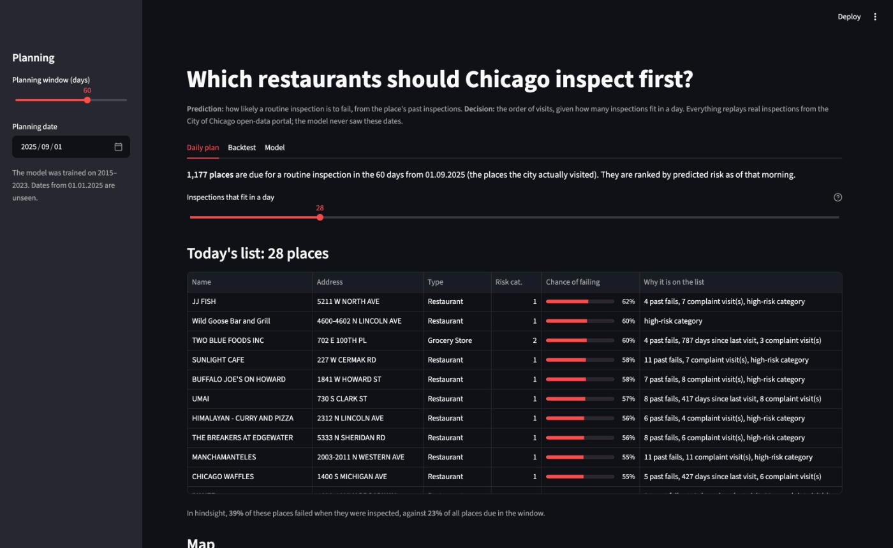
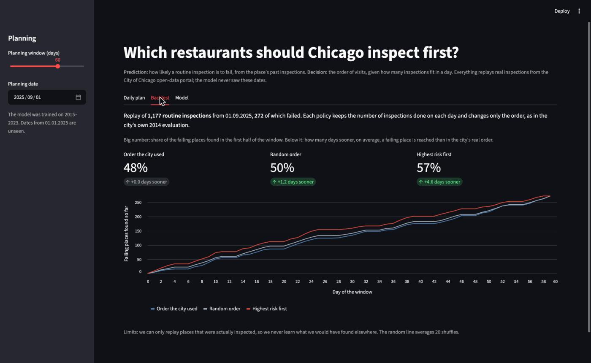

# Which restaurants should Chicago inspect first?

A small decision support system for the *Systemy wspomagania decyzji* (Decision Support Systems)
course at Warsaw University of Technology, MiNI, 2026/27.

Chicago has too few inspectors to visit every restaurant often. Since 2015 the city has used a
model to send them first to the places most likely to have serious violations. We rebuild that
idea on the city's open data:
- A **prediction module** estimates how likely each routine inspection is to fail.
- A **decision module** turns those estimates into a visiting order under a daily capacity.

A replay of past inspections measures how much sooner failing places would have been found.



## Quick start

Needs [uv](https://docs.astral.sh/uv/). Every dependency is pinned in `uv.lock`.

```sh
uv sync
uv run insp data       # download the city's export (about 330 MB) -> data/inspections.parquet
uv run insp train      # train the risk model, print its quality -> models/
uv run insp backtest   # replay Sep-Oct 2025 in three different orders
uv run streamlit run app.py
uv run pytest          # tests use small synthetic data, no download needed
```

`insp backtest --start 2026-03-02 --days 60` replays another window.

## How it works

```
city open data ─► features ─► risk model ─► scheduler ─► app ─► inspector's decision
(316k inspections) (history    (P(fail))    (order under    (list, map,
                   before date)             daily capacity)  replay)
```

| Part | File | What it does |
|---|---|---|
| Data | `src/inspections/data.py` | Downloads the [Food Inspections](https://data.cityofchicago.org/Health-Human-Services/Food-Inspections/4ijn-s7e5) export and cleans it |
| Features | `src/inspections/features.py` | For each inspection, facts known **before** that day: past fails, last result, days since the last visit, complaint visits, the city's risk category, type of place, location, month |
| Prediction | `src/inspections/model.py` | Gradient boosting against a logistic-regression baseline. Trained on 2015–2023, checked on 2024, tested on 2025–2026 |
| Decision | `src/inspections/schedule.py` | Orders the places due and fills each day's capacity; replays past windows to score any order |
| Interface | `app.py` | Streamlit: a daily list with reasons, a map, the replay and the model's quality |

**What counts as a failure.** We predict whether a routine (canvass) inspection ends with
*Fail*. The city's original model predicted "critical violations" instead. But the way violations
are written changed in July 2018, while the pass/fail result is consistent over the whole period.

**How the replay works.** This follows the city's own 2014 evaluation:
1. Take the routine inspections actually done in a 60-day window.
2. Keep the number done each day.
3. Change only the order: rank the places by predicted risk as of the first morning.
4. Count how many days sooner each failing place would have been reached.

## First results

Model quality on unseen inspections (fail rate overall: 23% in 2024, 22% in 2025–26):

| Model | AUC 2024 | AUC 2025–26 | Fail rate in the top 10%, 2025–26 |
|---|---|---|---|
| Gradient boosting | 0.645 | 0.615 | 34.7% |
| Logistic regression | 0.630 | 0.629 | 35.9% |

The replay, with the gradient boosting model choosing the order. "Days sooner" is the average for
failing places, compared with the order the city actually used:

| 60-day window from | Inspections | Failed | Days sooner | Failures found in the first half: city order → risk first |
|---|---|---|---|---|
| 06.01.2025 | 1,569 | 359 | +7.6 | 54% → 71% |
| 01.04.2025 | 1,678 | 380 | +8.1 | 49% → 70% |
| 01.09.2025 | 1,177 | 272 | +4.6 | 48% → 57% |
| 02.03.2026 | 1,135 | 236 | +5.0 | 41% → 53% |
| 01.07.2026 | 684 | 157 | +4.2 | 49% → 59% |

A random order is within ±1.3 days of the city's order in every window. For comparison, the
city's 2014 evaluation found critical violations 7.5 days sooner.



**Limits.**
- The model is only moderately accurate, and the logistic baseline is just as good on 2025–26.
- The replay can only reorder places that were actually inspected, so it never learns what an
  inspector would have found elsewhere.
- An [independent 2019 analysis](https://arxiv.org/abs/1910.04906) examines the city's model,
  its data and its evaluation.

## Plan

- The course plan, what the prototype covers and what comes next: [docs/plan.md](docs/plan.md).
- First draft of task 1 (the decision problem): [docs/z1-problem.md](docs/z1-problem.md).

## Sources

- [Food Inspections](https://data.cityofchicago.org/Health-Human-Services/Food-Inspections/4ijn-s7e5), City of Chicago data portal
- [Chicago/food-inspections-evaluation](https://github.com/Chicago/food-inspections-evaluation): the city's model code and evaluation
- V. Kannan, M. A. Shapiro, M. Bilgic, [Hindsight Analysis of the Chicago Food Inspection Forecasting Model](https://arxiv.org/abs/1910.04906), 2019
