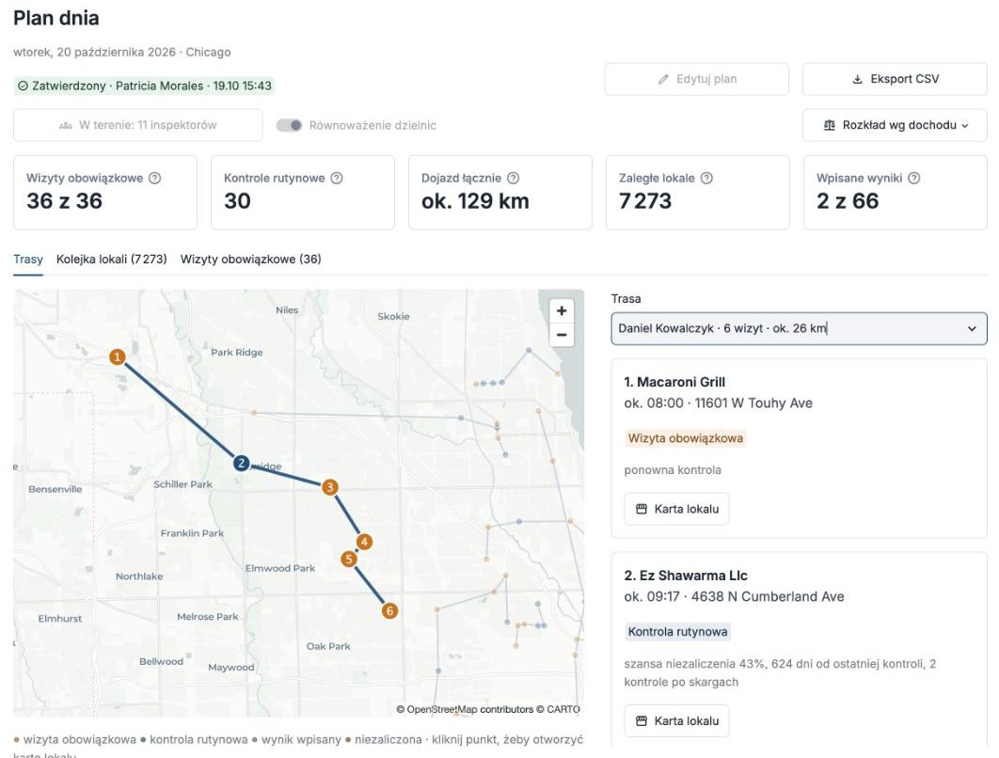
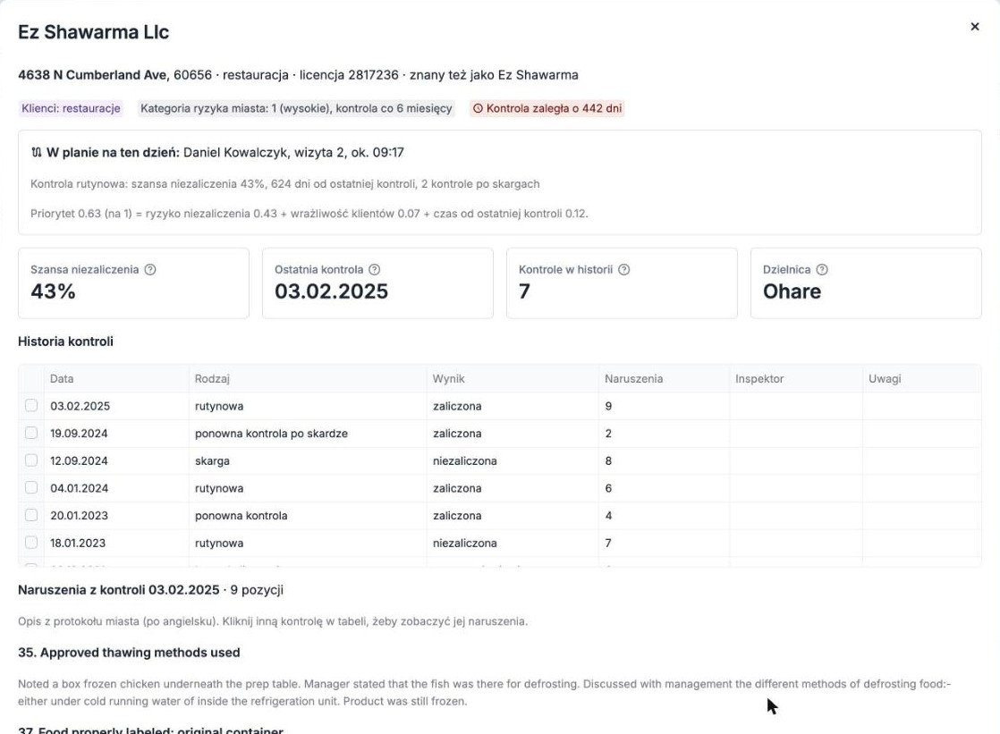

# Which restaurants should Chicago inspect first?

A decision support system for a city's food-inspection service, built only from the city's open
data. Course project for *Systemy wspomagania decyzji* (Decision Support Systems), Warsaw
University of Technology, MiNI, 2026/27.

The repository holds two separate apps.

**The product** (`app.py`) is what the inspection service would use at work.
- **Manager:** the day's plan.
  - The mandatory visits (complaints, licence checks, re-inspections) come first.
  - The remaining time goes to the most important places that are due for a routine inspection.
  - Each inspector who is in that day gets a route.
  - The manager can add or skip places, set the priorities and approve the plan. An approved
    plan is frozen; it can be edited until the first result comes in.
- **Team:** the inspectors, who is on leave or sick and until when, and visits still missing a result.
- **Inspector:**
  - their route for the day, the next visit first, with a navigation link;
  - why each place is on it;
  - a result form (pass, conditions, fail, no entry, closed) with a note.
- **Place card:** click a stop on any map or a row in any list to see the place's details,
  where it stands today, its full inspection history and the violations the city recorded.

Results feed back into planning. A visit counts once its result is recorded, so the place's
next due date and the model's features move. "No entry" does not count and the request comes
back. A failed visit brings a re-inspection request a week later.

**The technical report** (`report.py`) shows the analysis behind the system:
- model quality;
- the replay of 2025–26 against the order the city actually used;
- team-size scenarios;
- the fairness audit by neighbourhood income.





## Quick start

Needs [uv](https://docs.astral.sh/uv/). Every dependency is pinned in `uv.lock`.

```sh
uv sync
uv run insp data        # download the city's open data (~330 MB) and clean it
uv run insp train       # train, calibrate and audit the risk model
uv run insp evaluate    # replay 2025-26 for every policy and team size (~20 min; --quick for one window)
uv run insp demo        # optional: a lived-in app database (team, 8 days of plans and results)
uv run streamlit run app.py                          # the product, http://localhost:8501
uv run streamlit run report.py --server.port 8502    # the technical report
uv run pytest           # synthetic data, no download needed
```

There are no passwords. The sidebar switches between the manager and any inspector in one click.
The interface is in Polish. The prototype runs on historical data, so pick a working day in the
sidebar: it shows the requests that really came in that day and the places that were due.

`insp demo` resets the app's database to a fictional team of 13 inspectors with a few absences,
approved plans for the last 8 working days and their results. On the newest day the plan is
approved and no result is in yet. Results of requests are the ones the city recorded; results
of routine visits the system chose are drawn from the model's chance of failing.

`uv run insp plan --date 2026-10-20 --out plan.csv` prints one day's plan without the app.

## How it works

```
open data ─► data ─► prediction ─► decision ─► interface ─► manager approves ─► inspectors record results
(inspections, (canonical (chance of   (AHP priority,  (plan, map,                     │
 neighbourhoods, schema,  failing,     mandatory first, scenarios,                    │
 income)       areas)    calibrated)  routes, balance) fairness)                      ▼
     ▲───────────────────────────────── feedback: new results, `insp data` + `insp train` ◄─┘
```

| Module | File | What it does |
|---|---|---|
| City adapter | `city.py`, `cities/chicago.py` | Everything city-specific: data URLs, column and code mappings, facility groups, neighbourhoods, income data, inspection frequencies |
| Data | `data.py` | Downloads and cleans the inspections into a canonical schema; tags each with its neighbourhood; loads income by neighbourhood; keeps each inspection's violation notes in a separate file for the place card |
| Prediction | `features.py`, `model.py` | Chance that a routine inspection fails, from what was known before that day. Gradient boosting with Platt calibration; logistic baseline |
| Preferences | `preferences.py` | AHP: the manager compares criteria in pairs (risk, who eats there, time since the last visit) and vulnerability groups; consistency ratio check |
| Decision | `planning.py`, `routing.py` | Places that are due (counted from the last completed inspection) + the day's mandatory requests, those earlier plans did not get done and re-inspections after a failed visit → routes per inspector (OR-Tools, prize-collecting vehicle routing: priority vs driving time, 6 visits and 8 hours per inspector) |
| Fairness | `fairness.py` | Audit by neighbourhood income; balanced ordering that shares early visits in proportion to expected failures |
| Evaluation | `evaluation.py` | Replays 60-day windows of 2025–26 for six policies and four team sizes |
| State | `store.py`, `demo.py` | SQLite: the team and absences, approved plans (with the inputs they were made from), recorded results, saved preferences. Recorded results are fed back into the planning history. `demo.py` seeds a lived-in demo |
| Product | `app.py`, `ui.py`, `pl.py` | Streamlit. Manager: day plan (routes, queue, requests, income check), team, field results, priorities. Inspector: my visits. A place card from any map or list |
| Report | `report.py` | Streamlit. Replay results, team-size scenarios, fairness audit, model quality |

## Results

**Prediction.** Trained on 2015–2023, calibrated on 2024, tested on 2025–26 (13,447 routine inspections):
- AUC is **0.626**;
- the 10% of places ranked riskiest fail **35%** of the time, against 22% overall;
- the model is moderately accurate, which is why the plan combines it with other criteria and a
  person decides.

**Replay.** Results are averaged over five 60-day windows of 2025–26, with the full team. "Days
sooner" is how much earlier failing places are reached than in the order the city actually used.
Only places known before a window starts are reordered, described as they were then; visits to
places first seen inside the window keep their day.

| Policy | Days sooner, all failing places | Days sooner, failing schools, daycares, care homes | Failing places found in the first half | Km per visit |
|---|---|---|---|---|
| Order the city used | 0 | 0 | 48% | 3.1 |
| Random order (20 draws) | +0.3 | +0.4 | 49% | 3.4 |
| Risk only | **+6.5** | +5.8 | 63% | 3.3 |
| Risk + AHP preferences | +4.9 | +23.7 | 60% | 3.2 |
| AHP + neighbourhood balancing | +5.0 | +22.7 | 61% | 3.3 |
| **Full system** (AHP + balancing + routes) | +5.0 | **+23.7** | 60% | **1.7** |

- **Risk alone** finds failing places soonest overall (+6.5 days), but failing schools, daycares
  and care homes only +5.8 days sooner.
- **AHP preferences** give up 1.5 days of the overall gain and find those vulnerable places about
  **three weeks** sooner.
- **Routing** halves the driving per visit (1.7 km against 3.2) without losing either gain. The km
  are a like-for-like yardstick (the same router on each policy's routine visits), not real mileage.

**Smaller team.** Mandatory visits always come first, so the whole cut falls on routine
inspections. With a team 20% smaller, routine visits in a 60-day window drop from 1,236 to 688
(56%).
- The city's order reaches 53% of the failing places, which are found 14.0 days later on average
  than the city actually found them.
- The full system reaches 65%, found 9.6 days later than the city actually did.
- Places not reached in the window count as reached the day after it ends, so the delays are lower
  bounds.

The Wielkość zespołu page of the report shows 100%, 90%, 80% and 70%.

## Fairness

We checked whether the system treats poorer neighbourhoods differently. Neighbourhoods are split
into fifths by per-capita income, using the city's 2008–2012 indicators per community area.

- **Coordinates.** They can stand in for a neighbourhood's income. With them, the model gains
  only 0.007 validation AUC and actually does worse on 2025–26 (0.610 against 0.626). It also
  flags some income fifths almost twice as often as their places fail. **We drop them.**
- **The model without coordinates:**
  - it is equally calibrated in every income fifth (predicted vs actual fail rate within 3.4
    points);
  - its false-alarm rate is similar everywhere (60–67% of flagged places pass);
  - AUC is 0.61–0.67 in each fifth.
- **The plan:**
  - Neighbourhood balancing, on by default, shares early visits in proportion to each fifth's
    *expected* failures.
  - Over the replay, it narrows the burden ratio by fifth (share of early visits / share of failures)
    from 0.83–1.35 with plain AHP to 0.93–1.18.
  - Routing gives back part of that (0.87–1.29), because it clusters visits; the poorest fifth
    stays at 1.01.
  - With the full system, every income fifth gets its failing places found sooner than in the
    city's order: 2.0 to 11.3 days sooner.

## Adding a city

Everything city-specific is one `CityConfig` (see `src/inspections/cities/chicago.py`). To add a
city:
1. Write a config that says:
   - where the inspection export is and how its columns map onto the canonical schema
     (`place_id, name, facility_type, risk, address, lat, lon, date, inspection_type, result`);
   - which inspection types are routine, mandatory or complaints;
   - which results mean pass, conditional or fail;
   - how facility types fall into the five vulnerability groups;
   - where the neighbourhood boundaries and income data are.
2. Register it in `cities/__init__.py`.
3. Run `INSP_CITY=<slug> uv run insp data`, then `insp train`, then `streamlit run app.py`.

`tests/test_city.py` runs the pipeline on a made-up city to keep this honest.

## Limits

- **The replay** can only reorder inspections that actually happened, so it never learns what
  an inspector would have found elsewhere.
- **The inspection frequencies** by risk category (182 / 365 / 730 days) are our assumption and
  should be checked against the city's food code.
- **The routing assumptions** are also ours:
  - Manhattan distance at 20 km/h
  - 45 minutes per visit
  - routes that start at the first visit
- **The income data** is from 2008–2012, the newest the portal offers per community area.
- **Recorded results** feed the history the next plans are made from (due dates, the model's
  features), but `insp train` still learns from the city's data only.
- **The prototype runs on history:** a day's "requests" are the mandatory inspections the city
  really did that day. The demo team, plans and results are made up (see `insp demo`).

## Plan and sources

- [docs/plan.md](docs/plan.md): course tasks, status, who owns what. [docs/z1-problem.md](docs/z1-problem.md): first draft of the problem analysis.
- [docs/tech-report/report.pdf](docs/tech-report/report.pdf): short technical report in Polish (LaTeX, charts in pgfplots). `uv run python docs/tech-report/export_data.py` refreshes its data from `insp train` and `insp evaluate`; build with `pdflatex report.tex` twice.
- [Food Inspections](https://data.cityofchicago.org/Health-Human-Services/Food-Inspections/4ijn-s7e5), [Community Areas](https://data.cityofchicago.org/d/igwz-8jzy) and [socioeconomic indicators](https://data.cityofchicago.org/d/kn9c-c2s2): City of Chicago data portal.
- [Chicago/food-inspections-evaluation](https://github.com/Chicago/food-inspections-evaluation): the city's own 2014 model and evaluation, which inspired the replay.
- V. Kannan, M. A. Shapiro, M. Bilgic, [Hindsight Analysis of the Chicago Food Inspection Forecasting Model](https://arxiv.org/abs/1910.04906), 2019.
- T. L. Saaty, *The Analytic Hierarchy Process*, 1980. [OR-Tools](https://developers.google.com/optimization/routing) vehicle routing.
